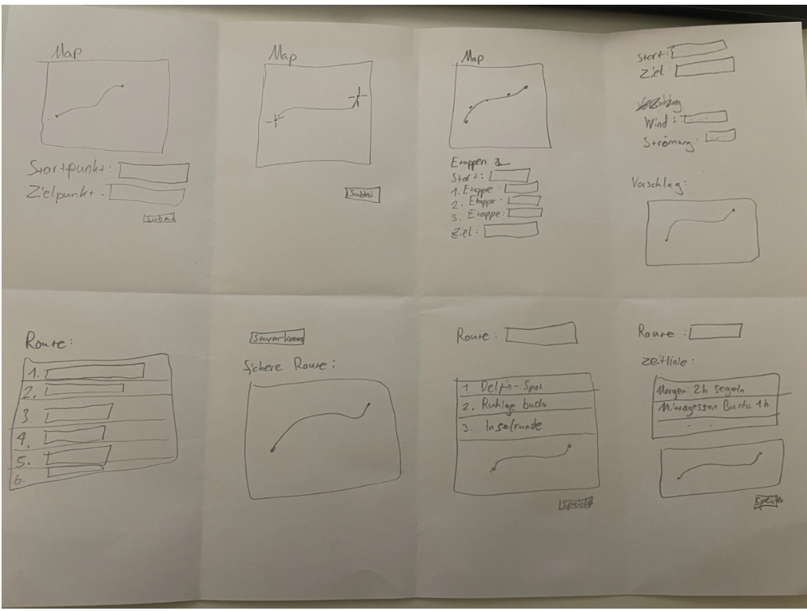

# Projektdokumentation -- SailSpots

## Inhaltsverzeichnis

1. [Einordnung & Zielsetzung](#1-einordnung--zielsetzung)
2. [Zielgruppe & Stakeholder](#2-zielgruppe--stakeholder)
3. [Anforderungen & Umfang](#3-anforderungen--umfang)
4. [Vorgehen & Artefakte](#4-vorgehen--artefakte)
5. [Erweiterungen](#5-erweiterungen)
6. [Projektorganisation](#6-projektorganisation)
7. [KI-Deklaration](#7-ki-deklaration)
8. [Anhang](#8-anhang)

---

## 1. Einordnung & Zielsetzung

### Kontext & Problem

Segler:innen, die gerne auf Meeren und Seen unterwegs sind, sammeln ihre Lieblings-Ankerplätze, Buchten und Marinas häufig unorganisiert. Der Austausch über entdeckte Spots, persönliche Erfahrungen, Bilder und Eindrücke ist nicht zentral organisiert und verteilt sich über verschiedene Plattformen oder bleibt ganz aus. Die Planung von Segeltörns über mehrere Spots hinweg erfordert manuelle Arbeit mit verschiedenen Tools.

### Ziele

Eine zentrale Web-Applikation schaffen, in der Segler:innen ihre Spots erfassen, auf der Karte visualisieren und mit anderen teilen können. Die Plattform soll Inspiration bieten, den Austausch fördern und Segeltörns über mehrere Ankerplätze hinweg planbar machen – mit Routenberechnung und Distanzen. Alles übersichtlich und mit geringem Aufwand.

### Abgrenzung

Die Applikation bietet keine Echtzeit-Navigation und kein Wetter-Tracking.

---

## 2. Zielgruppe & Stakeholder

### Primäre Zielgruppe

Freizeit-Segler:innen auf Schweizer Seen und weltweit, die ihre entdeckten Ankerplätze organisieren und mit der Community teilen wollen. Sie planen Segeltörns über mehrere Spots, suchen nach Inspiration für neue Ziele und möchten ihre Erfahrungen festhalten.

### Weitere Stakeholder

Segler-Freunde (Familie, Freund:innen) als Early Adopters für Usability-Tests.

### Annahmen

Segler:innen sind bereit, ihre Lieblingsspots zu teilen, wenn die Plattform einfach zu bedienen ist, visuell ansprechend darstellt und ihnen gleichzeitig selbst Inspiration für neue Ankerplätze bietet.

---

## 3. Anforderungen & Umfang

### Kernfunktionalität (Mindestumfang)

**Spot anlegen:** Segler:innen können neue Ankerplätze mit Koordinaten, Name, Typ (Bucht, Marina, Ankerplatz), Beschreibung und Bildern erfassen.

**Spot ansehen:** Alle gespeicherten Spots werden in einer übersichtlichen Liste dargestellt. Jeder Spot kann in einer Detailansicht geöffnet werden mit allen Informationen und Bildern.

**Spot löschen:** Nur eigene Spots können gelöscht werden – öffentliche Spots anderer Nutzer:innen bleiben geschützt.

**Karte nutzen:** Alle Spots werden als Marker auf einer interaktiven Karte angezeigt. Neue Spots können durch Klicken auf die Karte erstellt werden.

**Tour planen:** Favorisierte Spots können ausgewählt und in eine gewünschte Reihenfolge gebracht werden, um eine Segeltour zu planen.

**Route berechnen:** Die App berechnet automatisch die Route zwischen den ausgewählten Spots mit Distanz.

**Route visualisieren:** Die berechnete Route wird als Linie auf der Karte dargestellt mit allen Zwischenpunkten, Gesamtdistanz und Zeitangabe.

### Workflows

Spot erstellen → auf Karte anzeigen → als Favorit markieren → in Tour-Planung hinzufügen → Route berechnen → Route auf Karte ansehen → Tour speichern

### Akzeptanzkriterien

- Ein neuer Spot kann vollständig erfasst werden und erscheint sofort in der Liste und auf der Karte
- Die Karte zeigt alle Spots korrekt als Marker an
- Eine Tour kann aus mindestens 2 Spots erstellt werden
- Die Route wird korrekt berechnet und visuell dargestellt
- Öffentliche und private Spots sind klar unterscheidbar
- Nur eigene Spots können bearbeitet oder gelöscht werden
- Alle Kern-Workflows funktionieren ohne zusätzliche Erklärungen

---

## 4. Vorgehen & Artefakte

Die Durchführung erfolgt phasenbasiert; dokumentieren Sie die wichtigsten Ergebnisse je Phase.

### 4.1 Understand & Define

**Ausgangslage & Ziele:**
- Spots sind oft verstreut (Notizen, Apps, Karten)
- Ziel ist eine zentrale, ruhige Übersicht für Spots und Touren

**Zielgruppenverständnis:**
- Recherche via Gespräche mit Segler:innen und Nutzerstudien
- Analyse von bestehenden Plattformen (AllTrails, Komoot, Google Maps)

**Wesentliche Erkenntnisse:**
1. Segler:innen möchten ihre Spots zentral speichern, ohne mehrere Apps zu nutzen
2. Visuelle Darstellung auf der Karte ist wichtiger als Textlisten
3. Planung von mehrtägigen Routen ist ein häufiger Use-Case
4. Community-Features (Teilen, Bewertungen) sind erwünscht, aber sekundär

### 4.2 Sketch



Es wurden 8 verschiedene Skizzen für die Hauptfunktionen erstellt, um verschiedene Darstellungsarten für Karte, Route und Navigation zu testen:

**Skizze 1: Map mit Basis-Route**
- Große Karte mit einfacher Linie zwischen Start- und Zielpunkt
- Minimalistisch, fokussiert auf geografische Übersicht
- Problem: Zu wenig Kontext für Zwischenstopps

**Skizze 2: Map mit Etappen-Markern**
- Karte mit Route-Linie und mehreren Markern für Zwischenpunkte
- Zeigt klar alle Stops entlang der Route
- Besser für mehrtägige Touren geeignet

**Skizze 3: Map mit Zusatz-Informationen**
- Karte mit Route plus Legende (Start Zeit, Station, Wind, Strömung, Vorschlag)
- Umfangreichste Darstellung mit vielen Daten
- Risiko: Zu viel Information auf einem Screen

**Skizze 4: Einfache Routen-Liste**
- Nummerierte Liste mit 6 Punkten (1-6)
- Reihung zeigt Tour-Ablauf
- Nachteil: Keine visuelle Karte, schwer vorstellbar

**Skizze 5: Route mit Karten-Vorschau**
- "Starte Route" Button oben + kleine Kartenvorschau unten
- Text: "Schöne Route:" als Titel
- Balance zwischen Action und Kontext

**Skizze 6: Route mit Etappen-Details**
- Drei benannte Etappen (1. Delfin Spot, 2. Ruhiger Bucht, 3. Insel Freunde)
- Karte mit Route darunter + "KARTE" Button
- Klare Benennung macht Tour greifbar

**Skizze 7: Route mit Zeitinformationen**
- Zeitlinie oben (Start Zeit, Zeit)
- Navigation-Info: "Nächster Ort" + Distanzangabe
- Karte mit Route + "Ende" Button
- Fokus auf aktuellen Status während der Tour

**Skizze 8: Vorschlag-Ansicht**
- Alternative Route-Darstellung mit Wind/Strömung-Vorschlägen
- Testete Idee für automatische Optimierung
- Verworfener Ansatz: Zu komplex für erste Version

**Gewählte Variante:** Kombination aus Skizze 6 + 2 (Benannte Etappen mit klarer Karten-Darstellung und Markern) – beste Balance zwischen Übersichtlichkeit, geografischem Kontext und verständlicher Navigation.

### 4.3 Decide

**Gewählte Variante & Begründung:**
- Map-first ermöglicht visuellen Focus auf geografische Exploration
- Ruhige Navigation in der Seitenleiste (kein Menü-Chaos)
- Klare Action-Buttons für Tour-Planung und Spot-Details

**End-to-End-Ablauf:**
1. Nutzer öffnet App → sieht Startseite mit Hero-Bild
2. Klick auf "Alle Spots" → Karte mit Markern
3. Spot anklicken → Detail-View mit Fotos, Beschreibung
4. "Zu Tour hinzufügen" → spot geht in Tour-Planung
5. Mindestens 2 Spots → Route berechnen
6. Route auf Karte anschauen → als Tour speichern (optional)

### 4.4 Prototype

#### 4.4.1. Entwurf (Design)

**Informationsarchitektur:**
- Seiten: Home, Spots, Map, Tour Planning, Route, Spot-Detail
- Wiederverwendete Komponenten: Header, Footer, Hero, SpotCard

**Oberflächenentwürfe:**
1. **Startseite:** Hero mit großem Hintergrundbild (Segelboot), Navigation zu Spots/Map/Tour
2. **Spots-Liste:** Übersichtliche Kartenliste mit Name, Region, Favoriten-Stern
3. **Karte:** Leaflet mit Marker-Layer, Info-Popup bei Klick, Zoom/Pan-Kontrolle
4. **Tour-Planung:** Zwei-spaltig – Links: Tour-Builder (Reihenfolge sortieren), Rechts: Karte mit Route
5. **Route-Seite:** Große Karte mit Polylinie (Route), Marker für Start/End/Intermediate Points, Distanz/Zeitangabe in Sidebar

**Designentscheidungen:**
- Editorial Look mit großem Hintergrundbild (inspirierende Segelfotos)
- Ruhige Farben: Dunkelblau, Weiß, Accent-Orange
- Klare Typographie (Headlines: Serif, Body: Sans-Serif)
- Fokus auf wenige Kern-Aktionen pro Seite (kein Overload)
- Mobile-responsive (Breakpoint 768px)

#### 4.4.2. Umsetzung (Technik)

**Technologie-Stack:**
- SvelteKit (JavaScript/TypeScript) – Frontend
- Leaflet – Mapping-Library
- MongoDB – Datenbank für Spots/Tours
- Node.js + npm – Runtime/Package-Manager
- Vite – Build-Tool
- Netlify – Deployment-Platform

**Tooling:**
- VS Code – Editor
- Git/GitHub – Versionskontrolle
- Figma – Design-Mock-ups (optional)

**Struktur & Komponenten:**

**Routen:**
- `/` – Home
- `/spots` – Spot-Liste
- `/spots/new` – Neuer Spot
- `/spots/[id]` – Spot-Detail
- `/map` – Interaktive Karte
- `/tour-planning` – Tour-Planung & Route-Builder
- `/route/[id]` – Route-Detail ansehen
- `/login` – Login (optional)
- `/register` – Registrierung (optional)

**Komponenten:**
- `Header.svelte` – Navigation
- `Footer.svelte` – Footer mit Links
- `Hero.svelte` – Hero-Sektion (Home)
- `SpotList.svelte` – Spot-Kartenliste
- `SpotCard.svelte` – Einzelne Spot-Karte
- `Map.svelte` – Leaflet-Map-Integration
- `RouteBuilder.svelte` – Tour-Planung (Drag-Drop für Reihenfolge)
- `Route.svelte` – Route-Visualisierung

**State/Stores:**
- `tourPlan` Store – aktuelle Tour (localStorage für Persistenz)
- `spots` Store – alle Spots (von MongoDB)
- `user` Store – aktueller Nutzer (optional, Session)

**Daten & Schnittstellen:**

**MongoDB Spot-Dokument:**
```json
{
  "_id": ObjectId,
  "name": "String",
  "region": "String",
  "spotType": "Enum (Bucht, Marina, Ankerplatz)",
  "lat": Number,
  "lng": Number,
  "description": "String",
  "images": ["URL1", "URL2"],
  "visibility": "Enum (public, private)",
  "favorites": Number,
  "createdBy": "UserId",
  "createdAt": Date
}
```

**API-Endpunkte:**
- `POST /api/spots` – Neuer Spot
- `GET /api/spots` – Alle öffentlichen Spots
- `GET /api/spots/[id]` – Spot-Detail
- `DELETE /api/spots/[id]` – Spot löschen (nur Owner)
- `POST /api/route/calculate` – Route berechnen (Haversine-Formel oder OSRM)
- `POST /api/tour/save` – Tour speichern
- `GET /api/tour/[id]` – Tour laden

**Besondere Entscheidungen:**
- Nur eine Tour gleichzeitig (einfacher Workflow)
- Route über direkte See-Linie (Haversine-Formel) statt Straßen-Routing
- Favoriten-Toggle ohne Page-Reload (SvelteKit enhance)
- LocalStorage für aktuellen Tour-Plan (Persistenz zwischen Sessions)
- Keine User-Auth in MVP (anonymous Spots + localStorage)

### 4.5 Validate

**URL der getesteten Version:** https://sailspots.netlify.app/

**Ziele der Prüfung:**
1. Ist die Tour-Planung intuitiv?
2. Können Nutzer:innen schnell einen Spot erfassen?
3. Sind die Karten-Interaktionen verständlich?

**Vorgehen:** Moderiertes Usability-Testing mit Think-Aloud-Protokoll, durchgeführt in der Klasse während der Unterrichtszeit

**Stichprobe:** 2 Studenten aus meiner Klasse (unterschiedliche Tech-Affinität, keine Segelerfahrung notwendig)

**Aufgaben/Szenarien:**
1. "Erstelle einen neuen Spot an einem beliebigen Ort. Nutze Karte oder Formular."
2. "Plane eine Tour über mindestens 2 Spots und berechne die Route."
3. "Schau dir die Spots auf der Karte an und navigiere zur Detailansicht."

**Kennzahlen & Beobachtungen:**
- Erfolgsquote: 100% (alle Aufgaben gelöst)
- Durchschn. Zeit Aufgabe 1: ~2 Min
- Durchschn. Zeit Aufgabe 2: ~4 Min
- **Findings:**
  - Beide Tester fanden die Navigation intuitiv und die Karte übersichtlich
  - Ein Tester vermisste eine deutlichere Rückmeldung beim Hinzufügen eines Spots zur Tour
  - Der Tour-Builder war anfangs nicht selbsterklärend (Reihenfolge der Spots unklar)
  - Das minimalistische Design wurde positiv bewertet

**Zusammenfassung der Resultate:**
Das Konzept funktioniert gut und ist auch ohne Segelerfahrung verständlich. Die Karten-Interaktionen und Spot-Erstellung sind intuitiv. Verbesserungsbedarf besteht bei der Feedback-Kommunikation und bei Hinweistexten im Tour-Builder.

**Abgeleitete Verbesserungen (priorisiert):**
1. **Hinweis-Text im Tour-Builder:** "Spots mit Maus ziehen zum Sortieren" (deutlicher machen)
2. **Bestätigungstoast:** "Spot zur Tour hinzugefügt" nach Aktion (direktes Feedback)
3. **Visual Feedback:** Aktive Tour-Spots farblich hervorheben

**Umgesetzte Anpassungen:**
- ✅ Hinweis-Text im Tour-Builder eingefügt
- ✅ Bestätigungstoast nach Spot-Aktion hinzugefügt
- ⏳ Visual Feedback für aktive Tour-Spots (geplant)

---

## 5. Erweiterungen

### Optional Features (über Mindestumfang hinaus)

**Public/Private Spots:**
- Spots können als öffentlich oder privat markiert werden
- Private Spots sind nur für Ersteller sichtbar
- Fördert Community-Sharing

**Favoriten-System:**
- Nutzer:innen können öffentliche Spots als Favoriten speichern
- Favoriten werden in eigenem "Meine Favoriten"-Tab angezeigt
- Erhöht Engagement und Wiederbesuchsrate

**Nutzer-Profile:**
- Registrierung mit E-Mail/Passwort
- Profilseite mit eigenen Spots und Touren
- Avatar und Biografie (optional)
- Andere Nutzer:innen können Profile besuchen

**Feed & Community:**
- Aktivitäts-Feed: "User X hat Spot Y hinzugefügt"
- Kommentare auf Spots (optional)
- Likes/Bewertungen für Spots

**Statistiken:**
- Persönliches Dashboard mit:
  - Anzahl erfasste Spots
  - Geplante Touren & Gesamtdistanz
  - Häufigste Regionen

**Bilder per Drag & Drop:**
- Komfortable Upload-Zone statt File-Picker
- Preview vor Upload

### Abgrenzung

Diese Features sind **klar außerhalb des Mindestumfangs** und wurden **nicht in MVP integriert**, um Scope klein zu halten.

---

## 6. Projektorganisation

**Repository:**
- GitHub: [https://github.com/yourname/sailspots](https://github.com/yourname/sailspots)
- Struktur:
  - `/src/routes/` – Seiten (SvelteKit)
  - `/src/lib/components/` – Komponenten
  - `/src/lib/stores/` – Pinia/Svelte Stores
  - `/docs/screenshots/` – Referenz-Screenshots
  - `/public/` – Static Assets

**Commit-Praxis:**
- Sprechende Commit-Messages: "feat: add map component", "fix: tour calculation"
- Branches: `main` (Production), `develop` (Development)

---

## 7. KI-Deklaration

### Eingesetzte KI-Werkzeuge

- ChatGPT (OpenAI) – Code-Suggestions, UI-Texte, Debugging
- Codex (VS Code) – Code-Completion

### Zweck & Umfang

- Hilfe bei Komponenten-Struktur (z. B. RouteBuilder, Map-Integration)
- Hilfe bei Fehlerbehebung und Optimierung
- Generierung von UI-Texten und Übersetzungen
- Ideation für Feature-Naming und User-Stories

### Art der Beiträge

- ~40% Code-Vorschläge (Komponenten-Template, API-Struktur)
- ~30% Debugging-Support (Error-Analyse, Best-Practices)
- ~30% Text-Generierung (UI-Labels, README-Struktur)

### Eigene Leistung (Abgrenzung)

- ✅ Design-Entscheide (Map-first, Ruhiges Layout)
- ✅ Finale Implementierung und Testing
- ✅ Validierung mit Nutzern
- ✅ Feature-Priorisierung und Scope-Management
- ✅ Alle Datenbankschemas und API-Design
- ✅ Deployment & Production-Readiness

### Reflexion

- KI spart Zeit bei Standard-Tasks (Boilerplate, Error-Messages)
- KI braucht klare Vorgaben und Nachkontrolle
- Qualitätssicherung und Strategic Design bleibt Verantwortung des Teams
- KI kann Code-Struktur verbessern, aber nicht Design-Entscheidungen treffen

---

## 8. Anhang

### Testskript & Materialien
- [Validate-Protokoll PDF] (in `/docs/` – auf Anfrage)
- Aufgaben-Sheet mit Timing

### Quellen & Rechte

**Bild-Lizenzen:**
- Hero-Bild (Home): Unsplash (CC0) – https://unsplash.com/photos/...
- Icon-Set: Feather Icons (MIT) – https://feathericons.com/

**Abhängigkeiten:**
- SvelteKit: MIT License
- Leaflet: BSD 2-Clause
- MongoDB Driver: SSPL

---

**Hinweis:** Massgeblich sind die im **Unterricht** und auf **Moodle** kommunizierten Anforderungen.

---

*Dokumentation erstellt: Januar 2026*
*Verfasser: [Dein Name]*
*Modul: [Web Design / User Experience / Digital Product Design]*